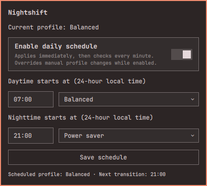

# Nightshift



An Omarchy shell plugin for daily, local-time power profile scheduling. It changes CPU power profiles, not screen color temperature.

## Use

Click the Nightshift icon at the right of the bar, or run:

```sh
omarchy-shell teomurgi.nightshift open
```

1. Enter daytime and nighttime start times in `HH:mm` (24-hour local time).
2. Choose a profile for each period: Balanced, Power saver, or Performance when available.
3. Click **Save schedule** (Enter in a time field also saves).
4. Switch on **Enable daily schedule**. The switch immediately saves its state and uses the last saved schedule, not unsaved edits.

Installed defaults: daytime 07:00 Balanced; nighttime 21:00 Power saver; scheduling **off**. Toggle off to leave the current power profile unchanged and stop enforcing the schedule.

The bar shows a dimmed power symbol when scheduling is disabled. When enabled, it shows the actual active profile: a leaf for Power saver, Omarchy's balanced symbol for Balanced, or a speedometer for Performance. Hover for the named status. Profile changes update the icon immediately without running an extra schedule check.

Tab navigates controls; Space activates the switch; Enter opens a dropdown or activates a focused button; arrow keys select dropdown entries; Escape closes the panel.

## Behavior

- One shared scheduler runs as an Omarchy service, independent of panel visibility and monitor count.
- Only runs while the Omarchy shell is running; no root service, system timer, or network access.
- Checks every minute while enabled, including after resume. Never wakes the computer. Startup and saving evaluate the current local time rather than replaying missed transitions.
- Each start time belongs to its new period. Periods can cross midnight; times must differ. Local timezone and daylight-saving changes are picked up on the next check.
- Enabled scheduling overwrites manual profile changes within one minute. Omarchy's AC/battery profile restoration can briefly change the profile before the next check. Do not run another profile scheduler alongside Nightshift.
- Disabling does not restore an earlier profile. Nightshift does not change Omarchy's remembered AC/battery profiles.
- Uses `busctl` to communicate with the installed power-profiles-daemon. Errors appear in the panel; failed saves keep the previous configuration active. Invalid saved configuration starts disabled.

Settings are saved atomically to `${XDG_CONFIG_HOME:-~/.config}/omarchy/nightshift.json`, outside the plugin folder so saving does not hot-reload the shell. Configure through the panel; external file edits require restarting the shell. English strings fall back through Omarchy's translation system.

## Installation and removal

Requires Omarchy's Quattro/Quickshell plugin runtime, its `qs.Commons` and `qs.Ui` components, `busctl` (systemd), and a running power-profiles-daemon. Node.js is only needed to run development tests. No installer, root access, external service, or network request is used by the plugin.

```sh
omarchy plugin add https://github.com/teomurgi/nightshift.git --enable
```

Start times use local time. Scheduling starts disabled on a fresh install. If no settings file exists, **Save schedule** creates it; the initial missing-file message clears after saving.

To stop and hide the plugin without uninstalling it:

```sh
omarchy plugin disable teomurgi.nightshift
```

To uninstall:

```sh
omarchy plugin remove teomurgi.nightshift
```

No privileged backend or systemd units need removal. Your schedule file is retained at `~/.config/omarchy/nightshift.json`; removing the plugin does not change the current system power profile.

## Author and license

Matteo Murgida <teomurgi@gmail.com>. MIT licensed; see [LICENSE](LICENSE).

## Development

```sh
node --test tests/model.test.cjs
```

Boundary tests cover exact transitions, midnight, intervals crossing midnight, and invalid schedules. GUI smoke checks exercised enable/disable, editing and persistence, rejected invalid times, and actual daemon switches between Balanced and Power saver.

The 1.0.1 live smoke check visually confirmed disabled, Balanced, Performance, and Power saver bar states. With scheduling enabled, a manual Performance selection remained unchanged at 20 seconds and was restored to scheduled Balanced by 65 seconds.

## Changelog

### 1.0.1

- Check the schedule every minute instead of every 15 seconds.
- Show a distinct disabled icon or the actual active power profile in the bar, with named status tooltips.

### 1.0.0

- Daily two-period profile schedule with GUI editing, persistent enable switch, current profile, next transition, and visible errors.
